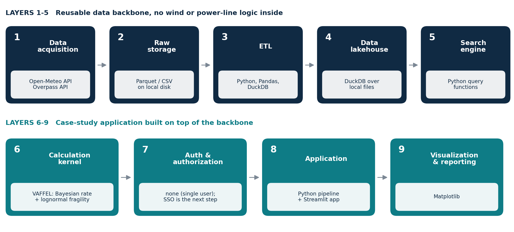

# VAFFEL: wind-dependent failure probability of transmission lines

Code for my MSc thesis at Politecnico di Torino, *Energy Informatics for Facilitating Large-Scale Research Applications*.

The thesis proposes a reusable 9-layer data architecture for energy research. This repository holds the case study built on top of it: an hourly probability of wind-related failure for 220 kV and 380 kV overhead lines in Sicily, computed with the VAFFEL method (Bayesian failure rate + lognormal fragility curve).



A one-page summary is in [docs/VAFFEL_thesis_one_pager.pdf](docs/VAFFEL_thesis_one_pager.pdf).

## What it does

1. Downloads hourly wind speed at 100 m (ERA5-Land through the Open-Meteo API, 2013 to 2023, 0.05 degree grid over Sicily) and transmission line and tower geometry (OpenStreetMap, Overpass API).
2. Matches every tower to its nearest wind grid point and builds one table with DuckDB and Pandas.
3. Estimates a Bayesian failure rate for each line (STEP 6).
4. Converts wind speed to a wind exposure and fits a lognormal fragility curve to each line (STEP 7 and 8).
5. Turns the hourly wind history into an hourly probability of failure per line (STEP 15).
6. Runs a wind-threshold sensitivity check on every line and a Sobol sensitivity analysis on one pilot line (STEP 13).
7. Benchmarks raw Parquet against a structured DuckDB table for the storage layer (STEP 17).

## Results

| | |
|---|---|
| Hourly failure probability, 380 kV lines | [results/step15_hourly_prob_380kv.png](results/step15_hourly_prob_380kv.png) |
| Hourly failure probability, 220 kV lines | [results/step15_hourly_prob_220kv.png](results/step15_hourly_prob_220kv.png) |
| Fragility curve, one line | [results/fragility_375924539.png](results/fragility_375924539.png) |
| Threshold sensitivity, one line | [results/threshold_sensitivity_338856348.png](results/threshold_sensitivity_338856348.png) |
| Fitted parameters of the 8 lines | [results/step8_params.csv](results/step8_params.csv) |
| Storage benchmark (raw numbers) | [results/step17_benchmark_results.json](results/step17_benchmark_results.json) |
| Interactive wind heatmap and lines | [results/map_heatmap.html](results/map_heatmap.html) (open in a browser) |

Storage benchmark, in short: on a single-field query a structured DuckDB table was 6.7 times faster than scanning raw Parquet (3.6 ms against 24.1 ms, mean of 3 runs on one laptop). It costs a one-time load of 8.7 s. For a joined query there was no real difference (61 ms against 60 ms).

## Important limits

- **The failure records are synthetic.** They are statistically plausible but were generated, not taken from a grid operator. The output shows that the method works from raw data to result. It is not a real risk estimate for any line.
- Eight lines are analysed (see [data/lines_summary.csv](data/lines_summary.csv)), out of the 116 lines found in Sicily.
- Everything runs on one machine.
- Developed and run on Windows with Python 3.13. The path handling is portable, but I have not run it on Linux or macOS.

## Repository layout

```
src/            the pipeline, one script per step (STEP1 ... STEP17) and two map scripts
app.py          Streamlit app to explore the fitted fragility curves
config.py       paths, the list of analysed lines, model parameters
data/           small input files (failure table, tower table, line summaries)
results/        selected figures and tables
docs/           architecture figure and one-page summary
```

The large inputs are not in the repository: the wind file is about 0.95 GB and the merged tower and wind file about 1 GB. STEP 1 and STEP 2 recreate them.

## Run it

```bash
pip install -r requirements.txt
```

The project folder is found automatically. To use another folder for data and results, set `VAFFEL_HOME`.

Explore the fitted curves, no download needed:

```bash
streamlit run app.py
```

Rebuild the full pipeline from the raw data (needs about 2 GB of disk and time for the downloads):

| Step | Script | Output |
|---|---|---|
| 1 | `src/STEP1_ERA5.py` | hourly wind Parquet file |
| 2 | `src/STEP2_MERGE_TOWERS_WIND.py` | towers merged with wind |
| 3 to 5 | `src/STEP3_...`, `STEP4_...`, `STEP5_...` | line lengths, failure table |
| 6 | `src/STEP6_BAYES_LAMBDA.py` | Bayesian failure rate per line |
| 7 | `src/STEP7_WIND_EXPOSURE.py` | wind exposure per line |
| 8 | `src/STEP8_FRAGILITY.py` | fragility parameters per line |
| 12, 14, 15, 16 | `src/STEP12_...`, `STEP14_...`, `STEP15_...`, `STEP16_...` | summary plots and hourly probabilities |
| 13 | `src/STEP13*.py` | sensitivity analyses |
| 17 | `src/STEP17_STORAGE_BENCHMARK.py` | storage benchmark |

Run each script from the repository root, for example `python src/STEP8_FRAGILITY.py`.

STEP 9 to 11 work on a per-segment variant and read intermediate files that are not included here, so they cannot be rerun from this repository.

## Verification

STEP 15 was rerun from a clean copy of this repository and gave the same hourly probability figures. The Streamlit app starts and renders without errors. The other scripts are syntax-checked but were not rerun end to end after the paths were made portable.

## Method and data sources

- VAFFEL is the method used to predict the hourly probability of failure of overhead lines from weather data. The thesis cites the original source.
- Wind: ERA5-Land through the [Open-Meteo](https://open-meteo.com/) historical API.
- Network: [OpenStreetMap](https://www.openstreetmap.org/) through the Overpass API.

## Author

Samereh Gheibi, MSc ICT for Smart Societies, Politecnico di Torino.
